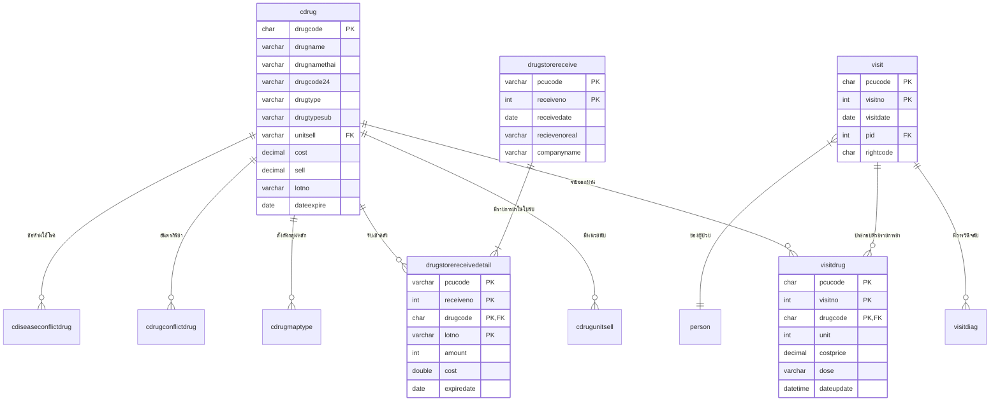

# คู่มือโครงสร้างฐานข้อมูล JHCIS (JHCIS Database Schema Reference)
> **วัตถุประสงค์:** ใช้เป็นเอกสารอ้างอิงโครงสร้างตาราง ฟิลด์ ดัชนี (Indexes) และความสัมพันธ์ (Foreign Keys) ของระบบ JHCIS สำหรับการพัฒนาระบบบริหารคลังยาและ Stock Card (JHCIS Drug Store)

---

## สารบัญตารางตามหมวดหมู่งาน (Table Categories)

1. [หมวดที่ 1: ทะเบียนยาและเวชภัณฑ์หลัก (Drug Master & Catalogs)](#1-ทะเบียนยาและเวชภัณฑ์หลัก)
   - `cdrug`, `cdrugmaptype`, `cdrugmapmixer`, `cdrugmapmodel`, `cdrugmappowerful`, `cdrugunitsell`, `cresondrug_outacc`, `cdrugremain`, `m2drug_control`
2. [หมวดที่ 2: การจ่ายยาและการให้บริการผู้ป่วย (Dispensing & Patient Visits)](#2-การจ่ายยาและบริการผู้ป่วย)
   - `visit`, `visitdrug`, `visitdiag`, `visitreceiptno`
3. [หมวดที่ 3: ระบบคลังยาและการรับ-เบิกจ่ายใน JHCIS (Inventory & Stock Repository)](#3-ระบบคลังยาและการรับ-เบิกจ่ายใน-jhcis)
   - `drugstorereceive`, `drugstorereceivedetail`, `drugrepositoryout`, `drugrepositoryoutdetail`, `drugrepositorytaken`, `drugrepositorytakendetail`, `drugstoretoloan`, `drug_to_draw`
4. [หมวดที่ 4: ความปลอดภัยด้านยาและข้อห้ามใช้ (Drug Safety & Interactions)](#4-ความปลอดภัยด้านยา)
   - `cdrugconflictdrug`, `cdiseaseconflictdrug`, `cdrugallergysymtom`
5. [หมวดที่ 5: วิธีใช้ยาและสูตรยาชุด (Doses & Formulas)](#5-วิธีใช้ยาและสูตรยาชุด)
   - `sysdrugdose`, `sysdrugformula`, `sysdrugformuladetail`, `sysdrugformuladetaildiag`, `sysdrughits`
6. [หมวดที่ 6: ตารางการตรวจทางคลินิกและงานเฉพาะทาง (Clinical Special Services)](#6-งานคลินิกและบริการเฉพาะทาง)
   - วัคซีน (`visitepi`), ทันตกรรม (`visitdentalcheck`, `visitdrugdental`), อนามัยแม่และเด็ก (`visitanc`, `visitbabycare`), เยี่ยมบ้าน (`visithomehealthindividual`), แล็บ (`visitlabblood`, `visitlabsugarblood`)
7. [แผนภาพความสัมพันธ์ (ER Diagram & Data Flow)](#แผนภาพความสัมพันธ์-er-diagram)
8. [การนำไปใช้ในระบบ Drug Store & Stock Card](#การนำไปใช้ในระบบ-drug-store--stock-card)

---

## 1. ทะเบียนยาและเวชภัณฑ์หลัก

### 1.1 `cdrug` — ทะเบียนยาและเวชภัณฑ์หลักของหน่วยบริการ
* **Primary Key:** `drugcode`
* **คำอธิบาย:** ตารางศูนย์กลางของยาและเวชภัณฑ์ทุกชนิดใน JHCIS

| ชื่อคอลัมน์ (Field) | ประเภท (Type) | ความหมายและหน้าที่ |
| :--- | :--- | :--- |
| `drugcode` | `char` | **(PK)** รหัสยาภายในของ รพ.สต. (Unique ID) |
| `drugname` | `varchar` | ชื่อยาภาษาอังกฤษ / การค้า |
| `drugnamethai` | `varchar` | ชื่อยาภาษาไทย |
| `druggenericname` | `varchar` | ชื่อสามัญทางยา (Generic Name) |
| `drugcode24` | `varchar` | รหัสมาตรฐาน 24 หลัก (TMT / กรมบัญชีกลาง / สนย.) |
| `tmtcode` | `varchar` | รหัส TMT (Thai Medicines Terminology) |
| `drugtype` | `varchar` | รหัสกลุ่มหลักของยา (เช่น 01=ยาแผนปัจจุบัน, 02=หัตถการ, 10=สมุนไพร) |
| `drugtypesub` | `varchar` | รหัสกลุ่มย่อย (เช่น หัตถการ: 1=ส่งเสริมทันตกรรม, 4=หัตถการแผนไทย) |
| `pack` | `varchar` | ขนาดบรรจุ (เช่น 1x1000 เม็ด) |
| `unitsell` | `varchar` | รหัสหน่วยนับ/หน่วยขาย (FK -> `cdrugunitsell.unitsellcode`) |
| `unitusage` | `varchar` | หน่วยวิธีใช้ (เช่น เม็ด, ซอง, ช้อนชา) |
| `unitpacking` | `varchar` | หน่วยบรรจุภัณฑ์ภายนอก (เช่น กล่อง, แผง, ขวด) |
| `cost` | `decimal` | ราคาทุนจัดซื้อต่อหน่วยจ่าย |
| `sell` | `decimal` | ราคาขาย / ราคาเบิกจำหน่ายต่อหน่วยจ่าย |
| `costcaldrugstore` | `decimal` | ราคาทุนคลังยา |
| `sellcaldrugstore` | `decimal` | ราคาขายคลังยา |
| `claim` | `decimal` | อัตราเบิกชดเชยตามสิทธิ (e-Claim) |
| `nationaccount` | `char` | สถานะบัญชียาหลักแห่งชาติ (ED / NED / ก, ข, ค, ง, จ) |
| `requisition` | `char` | เปิดให้เบิกได้หรือไม่ (1=ได้, 0=ระงับ) |
| `requisitionamount` | `int` | โควตา/จำนวนที่ให้เบิกได้สูงสุดต่อครั้ง |
| `amountstartdrugstore` | `int` | ยอดยกมาเริ่มต้นในคลังยา |
| `daystockremain` | `int` | เกณฑ์จำนวนวันสต็อกขั้นต่ำที่ต้องสำรอง |
| `stockempty` | `char` | ธงสถานะยาหมดสต็อก (Y/N) |
| `lotno` | `varchar` | หมายเลข Lot ปัจจุบันที่กำลังใช้อยู่ |
| `dateexpire` | `date` | วันหมดอายุของ Lot ปัจจุบัน |
| `datemfp` | `date` | วันที่ผลิต |
| `antibio` | `char` | ยาปฏิชีวนะ (Y/N) |
| `drugcaution` | `varchar` | คำเตือนและข้อควรระวังการใช้ยา |
| `drugproperties` | `varchar` | สรรพคุณยา |
| `drugflag` | `char` | สถานะการใช้งาน (1=เปิดใช้, 0=ยกเลิก/ปิดใช้) |
| `chargeitem` | `varchar` | หมวดหมู่ค่าบริการทางการแพทย์ (ตาม สปสช.) |

### 1.2 ตาราง Master เสริมของยา
- **`cdrugunitsell`**: ทะเบียนหน่วยนับยา (PK: `unitsellcode`, Name: `unitsellname`) เช่น เม็ด, แคปซูล, แผง, ขวด
- **`cdrugmaptype`**: กลุ่มหลักยา (PK: `drugmaptypecode`, Name: `drugmaptypename`)
- **`cdrugmapmodel`**: รูปแบบยา (PK: `drugmapmodelcode`, Name: `drugmapmodelname`) เช่น ยาเม็ด, ยาน้ำ, ยาทา
- **`cdrugmappowerful`**: ความแรงยา (PK: `drugmappowerfulcode`, Name: `drugmappowerfulname`)
- **`cdrugmapmixer`**: รูปแบบผสมยา (PK: `drugmapmixercode`, Name: `drugmapmixername`)
- **`cresondrug_outacc`**: รหัสเหตุผลการใช้ยานอกบัญชียาหลัก (PK: `rscode`, Name: `rsname`)
- **`cdrugremain`**: ยอดคงเหลือสะสมใน JHCIS (PK: `pcucode`, `drugcode`, `remain`, `requisition`)
- **`m2drug_control`**: ควบคุมระยะเวลาอนุญาตให้จ่ายยาต่อเนื่อง (PK: `id`, Index: `drugcode`, `days_permitted`)

---

## 2. การจ่ายยาและบริการผู้ป่วย

### 2.1 `visit` — ข้อมูลการมารับบริการของผู้ป่วย
* **Primary Key:** `(pcucode, visitno)`

| ชื่อคอลัมน์ (Field) | ประเภท (Type) | ความหมายและหน้าที่ |
| :--- | :--- | :--- |
| `pcucode` | `char` | **(PK)** รหัสหน่วยบริการ 5 หลัก |
| `visitno` | `int` | **(PK)** ลำดับ Visit ประจำวันหรือรันต่อเนื่อง |
| `visitdate` | `date` | วันที่มารับบริการ |
| `timestart` / `timeend` | `time` | เวลาเริ่มต้น / สิ้นสุดการรับบริการ |
| `pid` | `int` | รหัสบุคคล (FK -> `person.pid`) |
| `pcucodeperson` | `char` | รหัสหน่วยบริการของแฟ้มประชากร |
| `rightcode` / `rightno` | `char`/`varchar` | รหัสสิทธิการรักษา (เช่น UCS, OFC, SSS) และเลขที่สิทธิ |
| `hosmain` / `hossub` | `char` | รหัส รพ. แม่ข่าย และ รพ. รอง |
| `symptoms` | `varchar` | อาการสำคัญ (Chief Complaint) |
| `vitalcheck` | `varchar` | การตรวจร่างกาย |
| `weight` / `height` | `decimal` | น้ำหนัก (กก.) / ส่วนสูง (ซม.) |
| `pressure` / `pulse` | `varchar`/`int` | ความดันโลหิต / ชีพจร |
| `username` | `varchar` | ผู้ให้บริการ (FK -> `user.username`) |
| `flagservice` | `varchar` | สถานะการให้บริการ |

### 2.2 `visitdrug` — ประวัติการจ่ายยาในแต่ละ Visit (Stock Card ฝั่งจ่ายออก)
* **Primary Key:** `(pcucode, visitno, drugcode)`
* **Indexes:** `drugcode` (`cdrugvisitdrug`), `visitno` (`visitvisitdrug`), `(pcucode, doctor1)` (`vdr_user`)

| ชื่อคอลัมน์ (Field) | ประเภท (Type) | ความหมายและหน้าที่ |
| :--- | :--- | :--- |
| `pcucode` | `char` | **(PK)** รหัสหน่วยบริการ |
| `visitno` | `int` | **(PK)** รหัส Visit ที่สั่งจ่าย |
| `drugcode` | `char` | **(PK)** รหัสยาที่จ่าย (FK -> `cdrug.drugcode`) |
| `unit` | `int` | **จำนวนที่จ่ายออก** (หน่วยตัดสต็อก Stock Card) |
| `costprice` | `decimal` | ราคาทุนขณะสั่งจ่าย |
| `realprice` | `decimal` | ราคาขายจริงที่คิดกับผู้ป่วย/สิทธิ |
| `dose` | `varchar` | วิธีการใช้ยา (เช่น "1 เม็ด วันละ 3 ครั้ง หลังอาหาร") |
| `doctor1` | `varchar` | ผู้สั่งใช้ยา (แพทย์ / พยาบาล / นักวิชาการ) |
| `resondrugout` | `char` | รหัสเหตุผลการใช้ยานอกบัญชี (FK -> `cresondrug_outacc.rscode`) |
| `doctor3confirmalergic` | `varchar` | การยืนยันของแพทย์กรณีมีประวัติแพ้ยา |
| `dateupdate` | `datetime` | วันและเวลาที่บันทึกหรือจ่ายยา |

### 2.3 `visitdiag` — การวินิจฉัยโรค (ICD-10)
* **Primary Key:** `(pcucode, visitno, diagcode)`
* **ฟิลด์สำคัญ:**
  - `diagcode`: รหัสโรคตามมาตรฐาน ICD-10 (เช่น `I10`, `E11.9`)
  - `dxtype`: ประเภทการวินิจฉัย (`1`=Principal Dx, `2`=Comorbidity, `3`=Complication, `4`=Other)
  - `clinic`: แผนก/คลินิกที่ตรวจ

---

## 3. ระบบคลังยาและการรับ-เบิกจ่ายใน JHCIS

### 3.1 การรับยาเข้าคลังใหญ่ (`drugstorereceive` & `drugstorereceivedetail`)
* **`drugstorereceive` (หัวใบรับ):**
  - **PK:** `(pcucode, receiveno)`
  - `receiveno`: เลขที่ใบรับในระบบ JHCIS
  - `receivedate`: วันที่รับยาเข้าคลัง
  - `recievenoreal`: เลขที่ใบส่งของจริงจาก รพ. แม่ข่าย
  - `companyname`: ชื่อ รพ. แม่ข่าย หรือบริษัทผู้จัดส่ง
  - `receitype`: ประเภทการรับ (เบิก รพ., ซื้อเอง, รับบริจาค)
* **`drugstorereceivedetail` (รายการยาในใบรับ):**
  - **PK:** `(pcucode, receiveno, drugcode, lotno)`
  - `drugcode`: รหัสยา
  - `amount`: จำนวนรับเข้า
  - `cost`: ราคาทุนต่อหน่วย
  - `expiredate`: วันหมดอายุ
  - `lotno`: หมายเลข Lot
  - `remark`: หมายเหตุ

### 3.2 การเบิกจ่ายระหว่างคลังหลักและคลังย่อย
* **`drugrepositoryout` / `drugrepositoryoutdetail`**: การจ่ายออกจากคลังใหญ่ (PK: `pcucode, outno, runno, drugcode, dateexpire`)
  - ฟิลด์: `lotamount`, `packamount`, `remain`, `lotprice`, `lotunit`
* **`drugrepositorytaken` / `drugrepositorytakendetail`**: การรับเข้าคลังย่อย (ห้องจ่ายยา) (PK: `pcucode, takenno, drugcode, dateexpire`)
  - ฟิลด์: `lotamount`, `packamount`, `lotprice`, `lotunit`
* **`drugstoretoloan`**: การยืม-คืนยา (PK: `pcucode, loanno, drugcode`)
  - ฟิลด์: `loantype` (ยืมเข้า/ให้ยืม), `datetoloan`, `amount`, `loanhospital`
* **`drug_to_draw`**: ยาที่เตรียมขอเบิก (PK: `drugcode`)
  - ฟิลด์: `sumr`, `cost`, `amount`, `requisitionamount`, `remain`

---

## 4. ความปลอดภัยด้านยา

* **`cdrugconflictdrug` (Drug-Drug Interaction):**
  - **PK:** `(drugcode_a, drugcode_b)`
  - ระบุคู่ยาที่ห้ามใช้ร่วมกัน หรือเกิดปฏิกิริยาระหว่างกัน
* **`cdiseaseconflictdrug` (Drug-Disease Contraindication):**
  - **PK:** `(diseasecode, drugcode)`
  - ระบุยาที่ห้ามใช้ในผู้ป่วยที่มีโรคประจำตัวรหัส ICD-10 นั้นๆ
* **`cdrugallergysymtom` (อาการแพ้ยา):**
  - **PK:** `symtomcode`
  - ฟิลด์: `symtomname`, `icd10tm`

---

## 5. วิธีใช้ยาและสูตรยาชุด

* **`sysdrugdose`**: วิธีใช้ยาประจำตัวยา (PK: `pcucode, drugcode, doseno`)
  - ฟิลด์: `dosedescription` (ข้อความวิธีใช้), `doseprefix` (คำนำหน้าวิธีใช้)
* **`sysdrugformula` & `sysdrugformuladetail`**: สูตรยาชุดประจำโรค (PK: `pcucode, formulano, drugcode`)
  - ฟิลด์: `formulaname`, `diagcode` (โรคที่ใช้สูตรนี้), `amount` (จำนวนที่ตั้งไว้ในสูตร)
* **`sysdrughits`**: สถิติยาที่สั่งจ่ายบ่อย (PK: `pcucode, drugcode`, `unit`)

---

## 6. งานคลินิกและบริการเฉพาะทาง

| กลุ่มงาน | ตารางสำคัญ | ฟังก์ชันที่เกี่ยวข้องกับยา/เวชภัณฑ์ |
| :--- | :--- | :--- |
| **ทันตกรรม** | `visitdentalcheck`, `visitdrugdental` | บันทึกรหัสหัตถการและยาทางทันตกรรม |
| **วัคซีน (EPI)** | `visitepi`, `visitepiappoint`, `visitepicovid19aefi` | บันทึก `lotno`, `datevacineexpire`, ติดตามผลไม่พึงประสงค์ (AEFI) |
| **อนามัยแม่และเด็ก** | `visitanc`, `visitancdeliver`, `visitbabycare` | การจ่ายวิตามิน/ยาบำรุงครรภ์ (Iron, Folic, Iodine) |
| **วางแผนครอบครัว** | `visitfp` | เวชภัณฑ์คุมกำเนิด (ยาเม็ด, ยาฉีด, ถุงยางอนามัย) |
| **เยี่ยมบ้าน** | `visithomehealthindividual`, `visithomeappoint` | ตรวจสอบการใช้ยาที่บ้านและการคุมยาเรื้อรัง |
| **ชันสูตร/แล็บ** | `visitlabblood`, `visitlabsugarblood`, `visitlabcancer` | น้ำยาตรวจและแถบตรวจแล็บ (DTX, Strip) |

---

## แผนภาพความสัมพันธ์ (ER Diagram)

---

## การนำไปใช้ในระบบ Drug Store & Stock Card

### 1. โค้ดที่เชื่อมโยงกับ JHCIS ในปัจจุบัน (Current Implementations)
- **`backend/src/services/matcherService.js`**: Query จาก `cdrug` นำมาจับคู่ยาอัตโนมัติด้วย Levenshtein distance ร่วมกับ `drugcode24` และ `tmtcode`
- **`backend/src/services/stockCardService.js`**:
  - ตัดยอดจ่ายออก (Dispense) อ่านสดจาก `visitdrug` เชื่อมโยง `visit`, `cdrug`, `cdrugunitsell`, `person`, `visitdiag`
  - รองรับการดึงใบรับยาจาก `drugstorereceive` + `drugstorereceivedetail` ผ่านตัวเลือก `receiptSource: 'jhcis' | 'local' | 'both'`
  - แปลงประเภทและกลุ่มย่อยยาตาม `drugtype` และ `drugtypesub` (เช่น 02:หัตถการ -> 4:หัตถการ_แผนไทย)
- **`backend/src/routes/auth.js`**: ตรวจสอบสิทธิ์ผู้ใช้งานจากตาราง `user` โดยถอดรหัส AES-128 JHCIS Hash

### 2. โอกาสพัฒนาต่อยอด (Future Capabilities)
1. **Sync ใบรับยา 2 ทาง (JHCIS Receipt Sync):** สำหรับ รพ.สต. ที่คีย์รับยาใน JHCIS อยู่แล้ว สามารถดึงใบรับจาก `drugstorereceive` เข้าสู่ระบบ Stock Card อัตโนมัติโดยไม่ต้องนำเข้า Excel ซ้ำ
2. **ระบบแจ้งเตือนความปลอดภัยด้านยา (Clinical Decision Support):** ดึง `cdrugconflictdrug` และ `cdiseaseconflictdrug` มาแสดงคำเตือนเมื่อเภสัชกร/เจ้าหน้าที่ตรวจสอบประวัติการจ่ายยา
3. **การตรวจสอบความคลาดเคลื่อนสต็อก (Reconciliation against `cdrugremain`):** นำยอดคงเหลือจากการคำนวณ Stock Card FEFO ของระบบ ไปเทียบกับยอดคงเหลือใน `cdrugremain` ของ JHCIS เพื่อชี้เป้ายาที่มีผลต่าง (Discrepancy Report)
